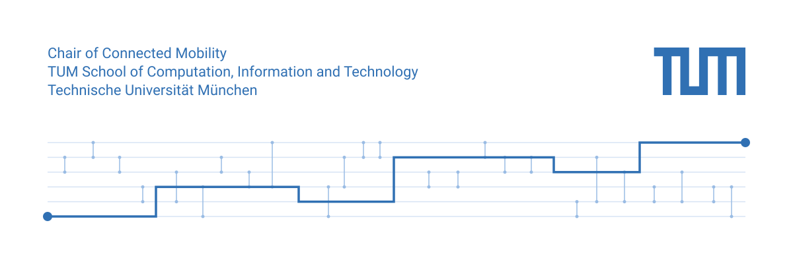

<picture>
  <source media="(prefers-color-scheme: dark)" srcset="https://raw.githubusercontent.com/TUM-cm/.github/main/profile/assets/banner-dark.svg">
  
</picture>

We are the [Chair of Connected Mobility](https://www.ce.cit.tum.de/cm/home/) at the Technical University of Munich. We study networked systems, applications, and services for mobile users. Much of our work is about how mobile devices connect to cloud services and how services can run locally on their own. We care about robustness, quality of experience, and user privacy.

The chair is led by [Prof. Dr.-Ing. Jörg Ott](https://www.ce.cit.tum.de/cm/research-group/joerg-ott/). Meet the rest of the [research group](https://www.ce.cit.tum.de/cm/research-group/) on our website.

## Research

- Mobile opportunistic networking and computing
- Network architecture
- New mobile application and service paradigms
- Mobile Internet measurements and analysis
- Mobility and user activity modeling
- Human-centered recommender systems

Application areas include Internet for All, local and autonomous networking, and secure and flexible cloud computing. Our papers are on the [publications page](https://www.ce.cit.tum.de/cm/publications/).

## Software

| Project | Description |
| --- | --- |
| [Oakestra](https://github.com/oakestra) | Lightweight hierarchical orchestration framework for edge computing |
| [NetMet](https://github.com/boserohan/netmet) | Browser extension for checking web and Internet performance |
| [EnGINE](https://engine-framework.pages.gitlab.lrz.de/engine/) | Orchestration of reproducible networking experiments |
| [The ONE](https://github.com/akeranen/the-one) | Simulator for opportunistic networks |

The full list is on our [software page](https://www.ce.cit.tum.de/cm/software-stuff/).

## Work with us

- [Open thesis topics and guided research](https://www.ce.cit.tum.de/cm/thesis-guided-research/open-thesis-topics-guided-research/)
- [Teaching](https://www.ce.cit.tum.de/cm/teaching/)
- [Jobs](https://www.ce.cit.tum.de/cm/jobs/)

## Contact

Find us at Boltzmannstraße 3, 85748 Garching bei München, Germany, or through the [contact page](https://www.ce.cit.tum.de/cm/contact/).
